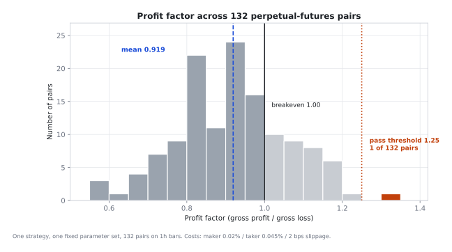
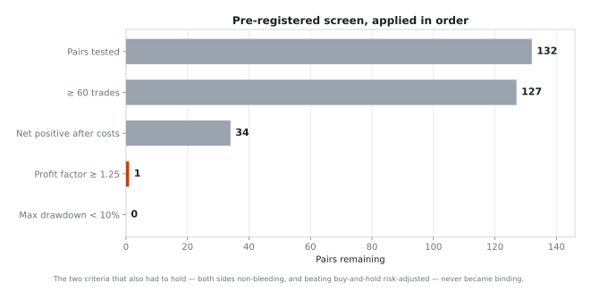
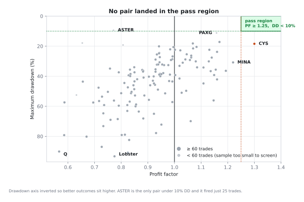
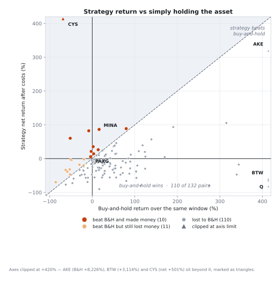
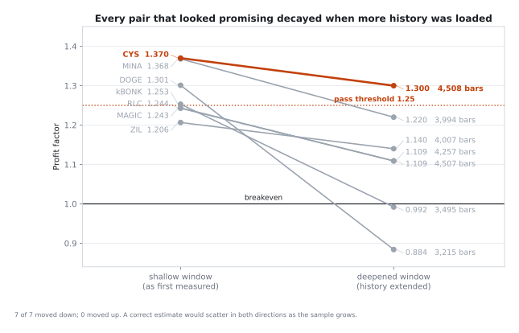
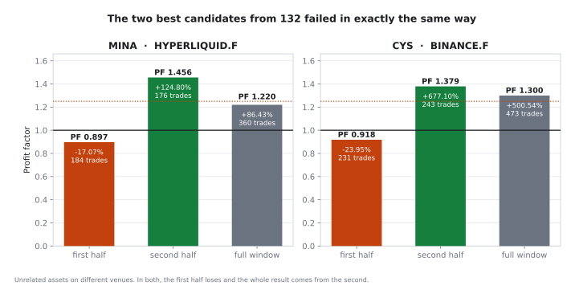

# Apakah scalper EMA maker-pullback punya edge di perp kripto?

**Sweep ter-pre-register atas satu strategi tetap di 132 pair perpetual futures, dua venue. Nol pair lolos.**

[English →](README.md)

---

## Ringkasan

Sebuah scalper trend-following maker-pullback — pasang limit order sejauh sebagian ATR di dalam tren EMA, kurung dengan stop dan take-profit — diuji tanpa perubahan apa pun di **132 pair perpetual futures**: 93 di Hyperliquid dan 39 di Binance, semuanya di bar 1 jam, semuanya dengan parameter dan asumsi biaya yang sama.

**Tidak ada satu pun pair yang memenuhi kriteria kelayakan.** Kriterianya ditulis sebelum pair pertama dibuka.

| Metrik | Nilai |
|---|---|
| Pair teruji | **132** (+ 5 pendahuluan) |
| **Pair yang lolos screening** | **0** |
| Profit factor — rata-rata / median | **0,919** / 0,929 |
| Profit factor — maks / min | 1,300 (CYS) / 0,567 (Q) |
| Pair dengan PF ≥ 1,25 (ambang) | **1** |
| Net positif setelah biaya | 35 dari 132 |
| Mengalahkan buy-and-hold | 21 — hanya **10** yang benar-benar untung |

Yang menarik bukan bahwa strateginya rugi. Yang menarik adalah **bentuk kerugiannya**, dan fakta bahwa tiga hal yang tampak seperti temuan ternyata larut begitu diuji dengan benar. Ketiganya adalah isi utama laporan ini.



Distribusinya terpusat di 0,919 dengan ekor tipis di atas 1,0. Itu bentuk yang diharapkan dari sinyal **tanpa edge yang membayar biaya transaksi**: titik tengahnya di bawah breakeven sebesar kira-kira biaya per trade, dan sebaran di sekitarnya adalah noise. Strategi yang punya edge tapi butuh pasar yang cocok akan menghasilkan *kelompok* pair di atas ambang — bukan satu outlier yang runtuh begitu diperiksa.

---

## Daftar isi

- [Pertanyaannya](#pertanyaannya)
- [Strategi yang diuji](#strategi-yang-diuji)
- [Metode](#metode)
- [Hasil](#hasil)
- [Tiga hal yang tampak seperti temuan](#tiga-hal-yang-tampak-seperti-temuan)
- [Studi kasus: dua kandidat terbaik](#studi-kasus-dua-kandidat-terbaik)
- [Apa yang akan mengubah kesimpulan](#apa-yang-akan-mengubah-kesimpulan)
- [Batasan](#batasan)
- [Reproduksi](#reproduksi)
- [Struktur repo](#struktur-repo)
- [Koreksi](#koreksi)

---

## Pertanyaannya

Bukan "bisakah strategi ini dituning sampai profit?" — apa pun bisa, di satu aset, dengan keuntungan melihat ke belakang. Pertanyaannya:

> Dengan satu set parameter yang dibekukan, apakah sinyal ini menghasilkan ekspektansi positif yang bertahan terhadap biaya, di cukup banyak instrumen sehingga hasilnya tidak bisa dijelaskan sekadar oleh "mencari sampai ada yang kelihatan bagus"?

Framing itu penting karena cara paling jelas untuk menjalankan sweep — uji banyak pair, ambil yang terbaik — **dijamin** menghasilkan pemenang, ada edge atau tidak. Dengan 95 tes independen pada peluang 5% terlihat bagus karena kebetulan, ekspektasinya sekitar **lima** "pemenang" semu murni dari noise. Protokol yang tidak memperhitungkan ini bukan mengukur edge; ia mengukur berapa banyak pair yang disapu.

---

## Strategi yang diuji

`HYPE Scalp v4 — maker pullback`, ditulis dalam wrun-ts untuk [openmarket.xyz](https://openmarket.xyz). Sumber: [`strategy/hype_scalp_v4_maker.ts`](strategy/hype_scalp_v4_maker.ts).

**Logika.** Ketika harga di atas EMA lambat dan EMA cepat di atas EMA lambat, pasang **limit buy** sejauh sebagian ATR di bawah harga penutupan; kebalikannya untuk short. Order dibatalkan kalau tidak terisi setelah `entry_ttl` bar. Begitu terisi, posisi dikurung stop dan take-profit limit pada kelipatan tetap dari unit risiko, plus time stop.

Titik desainnya adalah **struktur biaya, bukan prediksi**: limit entry yang menunggu membayar tarif maker dan tidak kena slippage, dan keluar lewat take-profit limit juga begitu. Hanya stop yang menyeberangi spread.

**Parameter, tetap sama di seluruh 132 pair:**

| Parameter | Nilai | Peran |
|---|---|---|
| `fast_len` / `slow_len` | 20 / 100 | gerbang tren EMA |
| `atr_len` | 14 | unit volatilitas |
| `pull_atr` | 0,5 | jarak limit entry dari close, dalam ATR |
| `stop_atr` | 1,0 | jarak stop, dalam ATR |
| `min_risk_pct` | 1,5 | lantai jarak stop, % harga entry |
| `rr` | 1,5 | take-profit sebagai kelipatan risiko |
| `be_trigger_r` | 8,0 | breakeven lock, diset cukup tinggi untuk mematikannya |
| `entry_ttl` | 3 | bar sebuah limit entry bertahan |
| `max_hold` | 96 | bar sebelum time stop |

Ini konfigurasi "wide-R" — terbaik dari 14 varian yang ditemukan di fase tuning satu-aset, didokumentasikan di [`docs/02-tuning-phase.md`](docs/02-tuning-phase.md). **Dibekukan sebelum sweep dimulai dan tidak pernah dituning ulang per pair**, dan itulah yang membuat setiap dari 132 pair menjadi tes out-of-sample sejati atas konfigurasi tersebut.

### Kenapa parameternya seperti itu

Fase tuning menghasilkan satu wawasan yang perlu dinyatakan, karena ia menjelaskan konfigurasinya dan berlaku umum.

Biaya round-trip diukur langsung dari fill, bukan diasumsikan: **≈ $5,26 per trade pada notional $10.000 — sekitar 0,053% dari notional**. Ekspektansi per trade kemudian:

```
ekspektansi_R  =  edge_mentah_R  −  biaya_per_trade / R
```

Dengan stop ketat, `R` kecil dan `biaya/R` besar — suku biaya mendominasi dan strategi tidak bisa menang sebaik apa pun sinyalnya. Melebarkan stop (`min_risk_pct` 0,3 → 1,5) dan membiarkan pemenang berjalan ke exit limit (`max_hold` 24 → 96, yang memindahkan exit dari `closeAll` berharga taker) mengecilkan drag biaya.

**Tapi melebarkan R mengurangi drag biaya; ia tidak menciptakan edge.** Pada biaya *nol*, plafon yang teramati di fase tuning adalah PF 1,125 — di bawah ambang kelayakan sebelum membayar satu basis poin pun. Itu seluruh hasil riset ini dalam bentuk miniatur, dan sweep 132 pair adalah konfirmasinya pada skala besar.

---

## Metode

### Engine dan model biaya

| | |
|---|---|
| Platform | openmarket.xyz Strategy Tester (wrun-ts) |
| Instrumen | `perps`, leverage 5, `qtyType: percentOfEquity` 20% → **notional $10.000** atas modal $10.000 |
| Model fill | `pessimistic` |
| Fee maker | 0,02% dari notional |
| Fee taker | 0,045% dari notional |
| Slippage | 2 bps pada fill yang menyeberang pasar |
| Funding | mati |
| Timeframe | 1h |

Biaya adalah **parameter** strategi, bukan konstanta, sehingga stress test cukup mengganti setting, bukan recompile.

Dua caveat jujur soal engine, keduanya membuat hasil jadi **optimistis**:

1. **Limit order terisi begitu harga menyentuh.** Tidak ada model antrean. Di live, order limit yang menunggu di harga sentuh sering tidak terisi. Ini menggelembungkan fill rate dari entry yang justru jadi andalan strategi ini.
2. **Funding dimatikan.** Funding perp adalah biaya berulang yang nyata untuk posisi yang ditahan. Eksposur rata-rata ~55–60%, jadi ini tidak bisa diabaikan.

Kedua bias menguntungkan strategi. Kesimpulannya negatif **meskipun** begitu.

### Protokol yang ter-pre-register

Ditulis ke tracker **sebelum pair pertama dibuka** dan tidak diubah setelahnya. Teks lengkap: [`docs/01-protocol.md`](docs/01-protocol.md).

Sebuah pair lolos screening hanya kalau **semua** ini terpenuhi:

| # | Kriteria | Alasan |
|---|---|---|
| 1 | **Profit factor ≥ 1,25** | Dinaikkan dari 1,2 sebagai koreksi multiple-testing, *sebelum* data terlihat |
| 2 | **Max drawdown < 10%** | |
| 3 | **≥ 60 trade** | Supaya split setengah sampel masih menyisakan ≥ 30 |
| 4 | **Net > 0 setelah biaya** | |
| 5 | **Kedua sisi tidak berdarah** | Sisi yang rugi tidak boleh > 50% profit sisi yang untung |
| 6 | **Kalahkan B&H risk-adjusted** | `net% / maxDD` > `B&H% / maxDD_B&H` |

Plus tiga aturan tetap:

- **Catat semua hasil**, bukan hanya yang positif. Tabel diisi berurutan tanpa pengecualian.
- **Nilai PF dan perbandingan terhadap buy-and-hold — bukan net %.** Net % tinggi di pasar yang naik 130% bukan temuan.
- **Jangan pernah tuning ulang per pair.** Setiap pair adalah tes out-of-sample atas satu konfigurasi beku.

Apa pun yang lolos screening lanjut ke protokol penuh: **split tuning/validation, stress test biaya, tetangga parameter ±20%, dan tes buang-trade-terbesar.**

### Aturan kedalaman data — ditambahkan di tengah sweep, dan kenapa

Di pair #11 sweep ini menabrak cacat metode yang cukup serius untuk membatalkan komparabilitas semua yang diukur sebelumnya.

**DOGE** terbaca **+30,30% dengan PF 1,301** di 1.715 bar — melewati ambang, mengalahkan buy-and-hold, kedua sisi positif. Setelah history diperdalam ke 3.215 bar, konfigurasi yang sama persis terbaca **−15,80% dengan PF 0,884**. Bukan melemah. Terbalik.

Jumlah bar belum distandarkan. Aturan yang ditambahkan sebagai respons, dan berlaku untuk sisa sweep:

> **Minimum 2.900 bar, dan jumlah bar dicatat di setiap baris.**
> Pair yang **lolos** di bar sub-standar **wajib diperdalam sebelum dicatat**.
> Pair yang **gagal** dicatat apa adanya dengan jumlah bar ditandai.

Asimetrinya disengaja. Memperdalam itu mahal, dan pair yang gagal tidak akan diselamatkan oleh data tambahan. Tapi pair yang **lolos** di window pendek adalah persis kasus di mana noise menyamar sebagai sinyal. Aturan ini ternyata jadi keputusan metodologis paling penting di proyek ini. Ia menangkap enam false positive.

---

## Hasil

### Screening, diterapkan berurutan



132 → 127 (≥ 60 trade) → 34 (net positif) → **1** (PF ≥ 1,25) → **0** (DD < 10%).

Dua kriteria terakhir — kedua sisi tidak berdarah, dan mengalahkan B&H risk-adjusted — tidak pernah jadi penentu, karena tidak ada yang bertahan cukup lama untuk diuji dengannya.

### Profit factor terhadap drawdown



Area lolos kosong. Tepat satu pair dari 132 punya drawdown di bawah 10% — **ASTER 9,4%** — dan ia hanya menghasilkan 25 trade dari 494 bar, jauh terlalu kecil untuk di-screen. Pair berperilaku terbaik dengan sampel yang memadai adalah **PAXG** (emas): DD 11,2%, kedua sisi positif, Sharpe +0,91, mengalahkan buy-and-hold. Gagal di PF (1,158) dan jumlah trade (48).

PAXG layak satu kalimat tersendiri, karena ia satu-satunya petunjuk kualitatif di seluruh dataset: kalau sinyal ini punya rumah alami, tempatnya di **instrumen volatilitas rendah yang bertren mulus**, bukan altcoin.

### Terhadap sekadar memegang asetnya



| Hasil | Pair |
|---|---|
| Mengalahkan buy-and-hold | 21 |
| Seri persis | 1 (PENGU) |
| **Kalah dari buy-and-hold** | **110** |

---

## Tiga hal yang tampak seperti temuan

### 1. Net % tinggi — jebakan AKE

**AKE** menghasilkan **+319,40%**. Berdiri sendiri, itu terbaca seperti temuan besar.

Profit factor-nya **1,061**, dan buy-and-hold di window yang sama menghasilkan **+8.225,6%**.

Strategi ini menangkap sekitar **4% dari yang diberikan kalau tidak melakukan apa-apa**, sambil menanggung drawdown 69,9%. Net % di pasar yang naik 82× mengukur leverage yang diterapkan pada tren, bukan keterampilan. Inilah kenapa protokol menetapkan PF — yang scale-invariant — sebagai kriteria utama, dan memperlakukan net % sebagai tidak informatif bila berdiri sendiri.

### 2. "Mengalahkan buy-and-hold" — sebagian besar bukan alpha

21 pair mengalahkan buy-and-hold. **11 di antaranya tetap rugi uang.**

| Pair | Strategi | Buy-and-hold |
|---|---|---|
| kBONK | −2,48% | −50,80% |
| BLUR | −4,68% | −48,90% |
| USELESS | −31,87% | −53,10% |
| SOPH | −38,57% | −58,50% |
| APR | −69,69% | −85,80% |

Mereka "menang" dengan rugi lebih sedikit daripada aset yang sedang jatuh. Dengan eksposur rata-rata sekitar 55–60%, itu **efek beta rendah dari eksposur pasar parsial** — mekanis, bukan alpha. Anda akan mendapat efek yang sama hanya dengan memegang 55% posisi dan tidak melakukan apa pun.

Hanya 10 dari 132 pair yang mengalahkan buy-and-hold *sambil juga untung*, dan tidak satu pun lolos screening.

### 3. Pemenang window pendek — temuan utamanya

Inilah hasil yang menyelesaikan pertanyaannya.



Tujuh pair mencapai atau mendekati ambang pada pembacaan pertama. **Setiap satunya turun saat data diperdalam. Tidak ada yang naik.**

| Pair | Dangkal | Dalam | Δ | Mendarat |
|---|---|---|---|---|
| DOGE | 1,301 @ 1.715 bar | 0,884 @ 3.215 | −0,417 | di bawah |
| kBONK | 1,253 @ 1.995 | 0,992 @ 3.495 | −0,261 | di bawah |
| MINA | 1,368 @ 2.744 | 1,220 @ 3.994 | −0,148 | di bawah |
| MAGIC | 1,2428 @ 2.757 | 1,109 @ 4.507 | −0,134 | di bawah |
| RLC | 1,2435 @ 2.757 | 1,109 @ 4.257 | −0,134 | di bawah |
| ZIL | 1,2065 @ 2.507 | 1,140 @ 4.007 | −0,066 | di bawah |
| **CYS** | **1,370 @ 2.758** | **1,300 @ 4.508** | **−0,070** | **di atas** |

**Kenapa peluruhan satu arah adalah diagnosisnya.** Kalau sebuah strategi punya edge nyata dan window pendek hanya mengukurnya secara tidak presisi, maka memperpanjang sampel akan menggerakkan estimasi **ke dua arah** — kadang naik, kadang turun — mengerucut ke nilai sebenarnya. Tujuh dari tujuh bergerak ke arah yang sama bukan ketidakpresisian. Itu tanda tangan estimasi yang **bias optimistis**, karena window pendeknya terpilih — secara implisit — justru karena terlihat bagus.

Besaran biasnya: **PF yang diukur di bawah ~3.000 bar berjalan 0,07 sampai 0,42 terlalu tinggi.**

Dua di antaranya layak catatan proses. RLC (1,2435) dan MAGIC (1,2428) masing-masing mendarat sekitar **0,007 di bawah** ambang. Aturannya hanya *mewajibkan* pendalaman untuk pair yang lolos. Keduanya tetap diperdalam — membiarkan margin pembulatan memutuskan verdict adalah persis penipuan-diri yang protokol ini ada untuk mencegahnya. Keduanya jatuh ke 1,109.

---

## Studi kasus: dua kandidat terbaik



Dua pair dari 132 mencapai protokol penuh. Keduanya gagal **secara identik**. Detail lengkap: [`docs/03-case-studies.md`](docs/03-case-studies.md).

### MINA — Hyperliquid, 3.994 bar

Full window: **+86,43%, PF 1,220**, DD 30,8%, 360 trade, kedua sisi positif, Sharpe 2,23.

Gagal PF di kedalaman penuh (1,220 < 1,25) dan DD (30,8% > 10%). Split-nya:

| Periode | Trade | Net | PF |
|---|---|---|---|
| Paruh awal (~98 hari) | 184 | **−17,07%** | 0,897 |
| Paruh akhir (~68 hari) | 176 | +124,80% | 1,456 |

Penting secara metodologis: **tidak ada tuning apa pun yang dilakukan di MINA** — parameternya diambil utuh dari aset lain. Jadi kedua paruh itu out-of-sample. Split ini karena itu tidak mengukur overfitting parameter; ia mengukur **stabilitas antarwaktu**. Dan strateginya tidak stabil.

### CYS — Binance, 4.508 bar

Hasil terkuat di proyek ini, dan satu-satunya pair yang PF-nya tetap di atas ambang pada kedalaman penuh.

| Uji | Hasil | |
|---|---|---|
| PF @ 4.508 bar | **1,300** | lolos |
| Stress test biaya (maker 0,05%, slippage 5 bps) | PF **1,2503** | lolos 0,0003 |
| Max drawdown | 18,4% | **gagal** (> 10%) |
| Paruh awal (231 trade) | **−23,95%**, PF 0,918 | **gagal** |
| Paruh akhir (243 trade) | +677,10%, PF 1,379 | |

Net full window: **+500,54%** melawan buy-and-hold **−68,7%**.

+500% itu butuh tiga kualifikasi sebelum berarti apa pun:

1. **Compounding.** Sizing `percentOfEquity` berarti ukuran posisi tumbuh bersama equity. Largest win $4.978 dan largest loss $4.754 terhadap modal awal $10.000 menunjukkan di akhir window, satu trade menggerakkan setengah akun awal. Angka headline-nya didominasi trade-trade terakhir, bukan konsistensi.
2. **Asetnya jatuh 68,7%.** Hampir seluruh profit dari sisi short (+$30.799 vs +$19.255 long), terkonsentrasi di satu runtuhan. Itu satu rezim yang menguntungkan, bukan mekanisme berulang.
3. **Paruh pertama rugi 24%.** Menjalankan ini sejak hari pertama data berarti kehilangan seperempat akun selama ~94 hari sebelum rezim menguntungkan datang — tanpa jaminan ia datang lagi.

**Observasi yang menentukan:** MINA dan CYS adalah aset tidak berhubungan di venue berbeda, ditemukan di batch terpisah dengan puluhan pair di antaranya. Keduanya hasil terbaik dari 132 tes. Dan keduanya gagal dengan **cara struktural yang persis sama** — paruh pertama negatif, seluruh hasil dari paruh kedua. Satu kasus seperti itu anekdot. Dua, dicapai secara independen, adalah properti strateginya.

---

## Apa yang akan mengubah kesimpulan

Dinyatakan di muka, supaya kesimpulannya bisa difalsifikasi, bukan sekadar diklaim:

- **Sekelompok pair di atas PF 1,25 pada kedalaman data penuh** — bukan satu, tapi cukup banyak sehingga jumlahnya melampaui prediksi multiple testing (~5 dari 95 karena kebetulan).
- **Kandidat yang kedua paruhnya positif**, atau setidaknya keduanya di atas PF 1,0.
- **Estimasi PF yang bergerak dua arah saat history diperpanjang.** Peluruhan satu arah 7-dari-7 saat ini adalah bukti tunggal terkuat melawan strategi ini; mematahkan pola itu akan melemahkan kesimpulan laporan ini secara material.
- **Hasil positif pada biaya nol yang melampaui PF 1,25.** Plafon fase tuning adalah 1,125 sebelum biaya apa pun. Kalau plafon itu bisa diangkat, analisis biaya jadi relevan lagi; sampai itu terjadi, ia tidak relevan.

---

## Batasan

Yang laporan ini **tidak** tegakkan:

- **Ini tidak menunjukkan bahwa logika EMA-pullback tidak berguna secara umum.** Yang diuji adalah satu parameterisasi, di bar 1h, di perp kripto, selama kira-kira 4–7 bulan sampai Oktober 2026. Timeframe lain di luar 5m/15m/1h/4h, rezim lain, dan pasar lain tidak diuji.
- **Biaya funding tidak dimasukkan.** Memasukkannya akan memperburuk hasil, bukan memperbaiki, jadi ini tidak mengancam kesimpulan negatif — tapi angka presisinya akan bergeser.
- **Fill-nya optimistis.** Limit order terisi saat harga menyentuh, tanpa model antrean. Arah bias yang sama.
- **Daftar simbol kedua venue dibatasi 100 pair paling aktif.** Perp yang kurang likuid tidak diuji. Spread dan slippage nyatanya akan melampaui asumsi 2 bps di sini, jadi memasukkannya kemungkinan memperburuk agregat.
- **Drawdown skalanya ikut ukuran posisi.** Kriteria DD 10% adalah satu-satunya aturan screening yang merupakan fungsi sizing, bukan fungsi sinyal. Pembaca yang menolak kriteria itu perlu mencatat bahwa kesimpulannya tidak bergantung padanya: **pada kedalaman data penuh hanya satu pair dari 132 yang mencapai PF 1,25, dan ia gagal uji stabilitas waktu.**
- **Angka per pair dibaca dari UI Strategy Tester platform**, ditranskripsi manual ke tracker. Transkripsi dilakukan langsung saat pengukuran, sebelum verdict dibentuk, tapi angkanya bukan hasil ekspor mesin.

---

## Reproduksi

```bash
# 1. Parse tracker mentah jadi dataset bersih
python scripts/parse_tracker.py raw/pair_sweep.md data/results.csv

# 2. Regenerasi semua figure di README ini
python scripts/make_figures.py
```

Butuh Python 3.11+ dan matplotlib. Kedua skrip deterministik — menjalankan ulang mereproduksi `data/results.csv` dan keenam SVG secara persis.

Untuk menjalankan ulang backtest-nya sendiri, Anda perlu akun openmarket.xyz, strategi dari [`strategy/`](strategy/), dan parameter di atas. [`docs/04-operational-notes.md`](docs/04-operational-notes.md) mendokumentasikan perilaku platform yang kalau tidak diketahui akan memakan waktu berjam-jam — termasuk satu yang bisa diam-diam menghasilkan angka salah.

---

## Struktur repo

```
├── README.md                      laporan ini (Inggris)
├── README.id.md                   versi Bahasa Indonesia
├── data/
│   └── results.csv                seluruh 138 baris, machine-readable
├── figures/                       enam SVG, di-generate dari data/
├── scripts/
│   ├── parse_tracker.py           tracker mentah → results.csv
│   └── make_figures.py            results.csv    → figures/
├── strategy/
│   ├── hype_scalp_v4_maker.ts     strategi yang diuji
│   └── hype_scalp_v5_wide_r.ts    konfigurasi beku, ditandai JANGAN DIPAKAI LIVE
├── docs/
│   ├── 01-protocol.md             protokol ter-pre-register, verbatim
│   ├── 02-tuning-phase.md         fase 14-varian satu aset
│   ├── 03-case-studies.md         MINA dan CYS lengkap
│   └── 04-operational-notes.md    jebakan platform dan cara hasil dibaca
└── raw/
    ├── pair_sweep.md              tracker kerja (Indonesia)
    └── backtest_log.md            log eksperimen (Indonesia)
```

### Kamus data — `data/results.csv`

| Kolom | Arti |
|---|---|
| `id` | Posisi di antrean tes. Berawalan `B` = batch 2. `—` = pendahuluan. |
| `batch` | `1` (Hyperliquid), `2` (Binance), atau `preliminary` |
| `pair` | Ticker sesuai listing venue |
| `venue` | `HYPERLIQUID.F` atau `BINANCE.F` |
| `bars` | Bar 1h yang termuat saat pengukuran |
| `trades` | Trade tertutup di window |
| `win_rate_pct`, `net_pct`, `profit_factor`, `max_dd_pct`, `buy_hold_pct` | Sesuai laporan Strategy Tester |
| `status` | `tested`, `tested_pf_unrecorded`, `untestable`, `duplicate` |

Hanya baris dengan `status == tested` dan `batch in (1, 2)` yang masuk hitungan 132. Sisanya tetap disimpan supaya file-nya bisa direkonsiliasi dengan tracker mentah secara kasatmata.

---

## Koreksi

Dibiarkan terlihat, bukan diperbaiki diam-diam, karena laporan tentang tidak menipu diri sendiri sebaiknya menunjukkan kesalahannya sendiri.

- **Rata-rata PF berjalan di tracker Indonesia dihitung manual dan melenceng.** Tracker menyebut rata-rata batch 1 = 0,911; hitung ulang dari seluruh 93 nilai tercatat memberi **0,9216**. Rata-rata gabungan **0,9192**, bukan 0,912 seperti dinyatakan di tengah sweep. `data/results.csv` adalah otoritatif; semua angka di README ini dihitung darinya.
- **Klaim di tengah sweep bahwa ">240 trade hampir selalu berarti hasil sangat negatif" adalah salah** dan dicabut di tracker saat itu juga. Mendaftar semua pair di atas 280 trade memberi 6 negatif melawan 4 positif.
- **Jumlah pair yang mengalahkan buy-and-hold kurang dihitung** di ringkasan lisan selama sweep (dilaporkan 20 dengan 7 untung). Angka benar dari dataset: **21 menang, 1 seri persis, 110 kalah**, dengan **10** dari 21 yang untung.

---

## Verdict

Hentikan pengembangan sinyal ini.

Buktinya bukan "belum ketemu konfigurasi bagus". Buktinya empat hal independen yang menunjuk ke arah sama: plafon profit factor 1,125 **pada biaya nol**, distribusi 132 pair yang terpusat di bawah breakeven, peluruhan satu arah tujuh-dari-tujuh saat sampel diperbesar, dan dua kandidat terbaik yang gagal dengan ketidakstabilan waktu identik di venue berbeda.

Bacaan jujur atas 132 tes out-of-sample adalah bahwa gerbang tren EMA plus pullback ATR — keluarga sinyal paling teroverfit di kripto ritel — tidak mengandung edge yang bisa dieksploitasi pada tingkat biaya ini. Mengurangi drag biaya dengan melebarkan R, yang dicapai fase tuning, membuat strategi ini rugi lebih lambat. Ia tidak membuatnya menang.

---

## Lisensi

Kode dan data di repo ini dirilis di bawah [Lisensi MIT](LICENSE).

**Ini riset, bukan nasihat keuangan.** Tidak ada konfigurasi yang didokumentasikan di sini yang lolos kriteria kelayakannya sendiri, dan tidak ada yang layak ditradingkan.
